# Intelli-Credit — AI-Powered Corporate Credit Appraisal

An end-to-end credit decisioning engine for Indian corporate lending. It ingests a
borrower's financial documents, cross-verifies what they declare against what actually
moved through their bank account, searches for adverse news outside the files they
supplied, scores creditworthiness on the Five Cs, takes a second opinion from a machine
learning model, and produces a 29-section Credit Appraisal Memo — with a written reason
for every point it awards or deducts.

**Live app: https://intelli-credit-genx.streamlit.app/**
*(hosted on Streamlit Community Cloud — the free tier hibernates inactive apps, so the first
visit may take 30–60 seconds to wake)*

Built for the National AI/ML Hackathon (IIT Hyderabad · Vivriti Capital).

---

## The problem

Indian corporate credit appraisal takes three to five weeks per borrower. The bottleneck
is not a shortage of data — it is that GST filings, bank statements, annual reports,
court records and a credit officer's own site-visit notes live in incompatible places and
nobody has time to reconcile them by hand. So revenue inflation goes undetected, warning
signs stay buried on page 147 of an annual report, and six months later when a loan sours,
the honest answer to "why did we approve this?" is often "the officer felt fine about it."

Intelli-Credit automates the reconciliation and writes down the reasoning.

---

## What is real, and what is not

Most prototypes blur this line. This table is the answer to "which parts actually work?"

| Capability | Status | What backs it |
|---|---|---|
| GST vs bank reconciliation | **Real logic** | Variance bands, circular-trading detection on near-mirror transactions |
| Revenue inflation detection | **Real logic** | Declared turnover vs bank inflows, 1.30× trigger |
| PDF extraction + OCR fallback | **Real logic** | pdfplumber → PyPDF2 → Tesseract, 4 stages |
| Extraction confidence | **Real logic** | Every figure traced to its source sentence; missing figures reported, never invented |
| Document retrieval (RAG) | **Real logic** | TF-IDF cosine similarity, 6 risk themes, chunk-level attribution |
| Qualitative notes → score | **Real logic** | 10 keyword rules mapping officer prose to Five Cs adjustments |
| Five Cs scorecard | **Real logic** | 100-point scale, every adjustment logged with a reason |
| Secondary research (news) | **Real logic** | Live Google News RSS across 5 query templates, keyword-scored |
| ML risk prediction | **Real, synthetic training** | RandomForest, 23 features, 0.876 CV accuracy — trained on synthetic data, not a real loan book |
| Per-decision ML explanation | **Real logic** | Leave-one-out counterfactuals, computed per borrower |
| Hybrid decision fusion | **Real logic** | ML cannot override the scorecard below 90% confidence |
| CAM generation (TXT/DOCX/PDF) | **Real logic** | 29 sections, python-docx + ReportLab |
| Sector risk profiles | **Analyst reference data** | `data/sector_profiles.json`, 8 sectors, dated and sourced |
| CIBIL Commercial | **Placeholder** | No bureau access available to a prototype |
| GSTR-2A vs 3B | **Placeholder** | Requires registered GSP credentials |
| e-Courts litigation | **Proxy only** | Approximated via news search + manual notes |
| Databricks ingestion | **Not implemented** | Local file ingestion only |

---

## Quick start

Requires Python 3.13. For scanned-PDF support you also need the Tesseract binary on your
PATH ([Windows installer](https://github.com/UB-Mannheim/tesseract/wiki)); everything else
works without it.

```bash
python -m venv .venv
```

```bash
.venv/Scripts/python.exe -m pip install -r requirements.txt
```

```bash
.venv/Scripts/python.exe -m streamlit run app.py
```

Open http://localhost:8501, leave **Demo Mode** on, and click **Run Intelli-Credit
Analysis**. Three borrower scenarios are bundled: one that should be approved, one that
should be declined, and one that genuinely lands in the middle.

---

## How it works

A full-resolution architecture diagram is at [docs/architecture.svg](docs/architecture.svg).
The summary below is the same flow in text.

```mermaid
flowchart TD
    A[Bank CSV · GST · ITR · PDFs · Analyst notes] --> B[Ingestion<br/>4-stage PDF pipeline + OCR]
    B --> C[Document intelligence<br/>figures + evidence + data gaps]
    A --> D[GST × bank reconciliation<br/>mismatch · circular trading · inflation]
    C --> E[Retrieval<br/>TF-IDF over 6 risk themes]
    F[Secondary research<br/>news · NCLT · RBI/SEBI] --> G
    C --> G[Adjustment ledger<br/>factor · points · reason · evidence]
    D --> G
    E --> G
    H[Qualitative notes<br/>10 keyword rules] --> G
    G --> I[Five Cs scorecard<br/>100 points]
    I --> J[RandomForest<br/>23 features]
    I --> K[Hybrid fusion<br/>ML needs 90% to override]
    J --> K
    K --> L[29-section CAM<br/>TXT · DOCX · PDF]
```



Every signal — whether it came from a document, a bank statement, an analyst's typed note
or a news headline — enters the same ledger in the same shape: which of the Five Cs it
affects, how many points, why, and what evidence supports it. That single ledger is what
makes the CAM, the explainability table and the audit trail fall out for free.

### Two pieces of logic worth pointing at

**Circular trading detection.** Counts transactions where money arrives and leaves the same
row within ₹25,000 of each other — the signature of round-tripping funds to fake turnover.
Eight or more such rows flags High.

**Limits are capped by bank throughput, not declared revenue.** The recommended limit is the
lower of 12% of revenue and 20% of money that actually passed through the bank. Revenue on
paper can be inflated; bank throughput is much harder to fake. When revenue cannot be
extracted at all, the limit falls back to the throughput cap alone rather than assuming one.

---

## Decision logic

### Five Cs scorecard

Each dimension starts at 20 points. Penalties and boosts are deterministic rules, and every
one appends `{factor, type, points, reason}` to the ledger.

| Dimension | Principal signals |
|---|---|
| Character | Litigation and governance mentions, promoter news, retrieved governance evidence |
| Capacity | Operating cash flow **as a margin on revenue**, GST-bank mismatch, revenue inflation |
| Capital | Debt/revenue and liability/revenue ratios |
| Collateral | Security quality derived from due-diligence notes |
| Conditions | Sector headwinds, regulatory exposure, circular trading |

**≥75 = Low risk · 50–74 = Moderate · <50 = High.**

Cash flow is judged as a *margin*, not an absolute rupee amount — ₹42 crore is thin against
₹820 crore of revenue and strong against ₹200 crore, and a fixed threshold cannot express
that.

### ML second opinion

RandomForest (260 trees, depth 8) over 23 engineered features, trained on 700 synthetic
borrowers generated from a latent quality variable. 5-fold CV accuracy **0.876**, surfaced
in the UI — a model offered as a second opinion should state how good it is.

The prediction is the model's alone. An earlier version blended it 35/65 with a hardcoded
linear formula; that surrogate was removed, and a test fails if it is ever reintroduced.

Explanations are **per borrower**, not global. For each feature the model is re-run with
that input set to its training median, and the drop in confidence is its contribution. This
can show that a decision was reached *despite* a signal — something a global feature
importance table structurally cannot express.

### Hybrid fusion

| Situation | Outcome |
|---|---|
| Scorecard and ML agree | Adopt the shared decision |
| Disagree, ML ≥ 90% confident | Conservative override — the more cautious of the two |
| Disagree, ML < 90% | Scorecard is trusted |

The machine can never unilaterally approve a loan the rulebook considers risky. The limit
is then calibrated by a multiplier clamped to 0.45×–1.30×, with a ₹50 lakh floor.

---

## Project structure

```
app.py                     Streamlit UI — 14 tabs, renders one cached analysis
modules/
  pipeline.py              The whole appraisal, Streamlit-free and testable
  ingestion.py             PDF pipeline: native → PyPDF2 → OCR → fallback
  data_loader.py           CSV/XLSX loading and column normalisation
  document_intel.py        Figure extraction with evidence and confidence
  reconciliation.py        GST vs bank cross-verification
  rag_engine.py            Chunking, TF-IDF index, themed retrieval
  live_research.py         News/NCLT/regulatory search and scoring
  research_insights.py     Sector baseline, loaded from data/
  research_agent.py        Structured intelligence panel
  qualitative.py           Analyst prose → Five Cs adjustments
  scoring.py               The 100-point scorecard and its ledger
  recommendation.py        Decision, limit and pricing from the score
  ml_hybrid.py             RandomForest, features, per-instance attribution
  hybrid_recommendation.py Scorecard/ML fusion and limit calibration
  indian_context.py        India-specific indicator cards
  cam_generator.py         29-section memo text
  cam_export.py            DOCX and PDF export
  demo_scenarios.py        Three bundled borrower cases
data/sector_profiles.json  Analyst-maintained sector risk baselines
sample_data/               Sample inputs and offline research fixtures
tests/                     135 tests across 10 files
```

---

## Deploying it

The whole system is one Streamlit process — no separate API, no database — so there is
exactly one thing to host.

| Platform | Free? | Notes |
|---|---|---|
| **Streamlit Community Cloud** | Yes | Point it at this repo and `app.py`. Reads `requirements.txt` and `packages.txt` automatically |
| **Hugging Face Spaces** | Yes | Choose the Streamlit SDK. Same two files are picked up |
| Render | Free tier | Spins down after 15 min idle; first visit then takes ~50s |
| Railway | No longer free | Trial credit only |

**Vercel will not work.** Streamlit is a long-lived stateful server holding a WebSocket per
session; Vercel runs stateless short-lived functions. Hosting there would mean rewriting the
UI in React and running the Python behind a separate API — two services instead of one.

Two things to know before deploying:

- `packages.txt` installs the Tesseract binary. Without it OCR silently falls back, so
  scanned-PDF support would not actually work on the deployed instance.
- `requirements.txt` is pinned against Python 3.13. If a host defaults to an older Python
  and a wheel is unavailable, relaxing the `pandas` pin is safe — the code uses `.ffill()`
  rather than the removed `fillna(method=)`, so it runs on pandas 2.x as well.

---

## Tests

```bash
.venv/Scripts/python.exe -m pytest
```

135 tests. The suite includes **golden-output snapshots** of all three demo scenarios —
scores, decisions, limits, pricing bands — so any change that moves a number has to move it
deliberately. Tests never touch the network: research tests force a sub-millisecond timeout
to exercise the offline path.

---

## Known limitations

Stated plainly, because being caught on these is worse than declaring them.

- **The ML model has never seen a real loan book.** It is trained on 700 synthetic borrowers
  drawn from a latent quality variable. The reported 0.876 accuracy measures whether it
  learned that generating structure — not how it would perform on real lending outcomes.
  Treat it as a consistency check on the scorecard, not as independent evidence.
- **CIBIL Commercial and GSTR-2A vs 3B are placeholders.** Both need credentials a prototype
  cannot obtain. They are labelled as placeholders in the UI rather than mocked silently.
- **e-Courts is approximated**, via news search and manual analyst input.
- **Databricks ingestion is not implemented.** The problem statement names it; this build
  reads local files only.
- **OCR needs Tesseract installed separately.** The Python wrapper is declared in
  `requirements.txt`, but the binary is a system dependency.
- **Retrieval barely engages in Demo Mode.** The bundled scenario narratives are short
  enough to produce a single chunk each, which makes IDF weighting degenerate. Retrieval
  does real work on uploaded multi-page PDFs.
- **Secondary research depends on Google News RSS.** When it is unreachable the app falls
  back to bundled sample headlines, every one of which is prefixed `[OFFLINE SAMPLE]` so
  synthetic data can never be mistaken for real reporting — including in the exported CAM.
- **This is a prototype, not an underwriting system.** No authentication, no persistence,
  no multi-user support.

---

## Future scope

- Databricks adapter for enterprise-scale ingestion
- Real bureau (CIBIL Commercial) and GSTN API integration
- Sanction-letter parsing to net existing exposure against the recommended limit
- Training on real historical approval and default outcomes
- LLM-assisted document summarisation, with the decision logic kept rule-based

---

## Built by

| | |
|---|---|
| Developer | Ayush Ranjan |
| Institution | Goa Institute of Management |
| Hackathon | National AI/ML Hackathon — IIT Hyderabad · Vivriti Capital |
